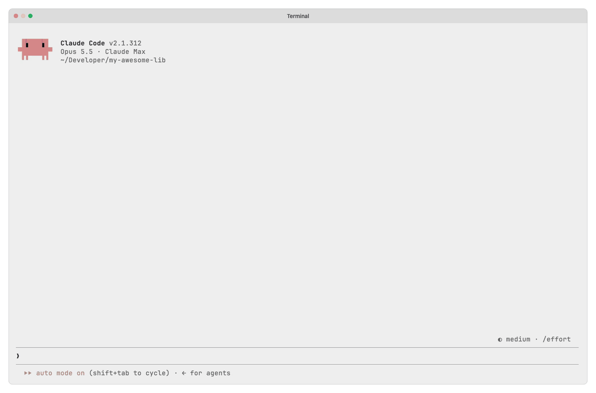
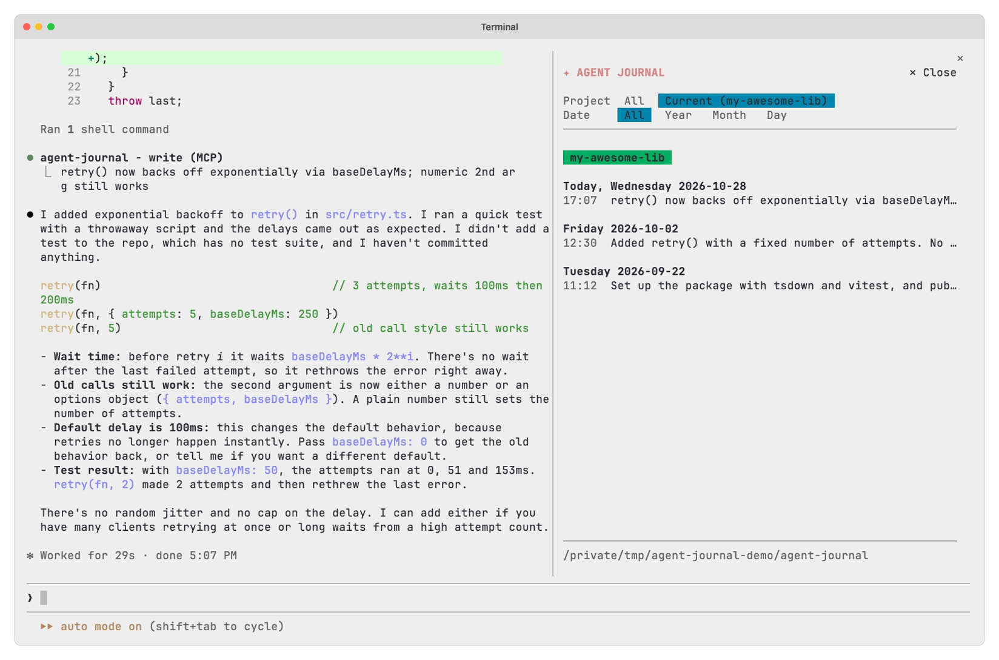
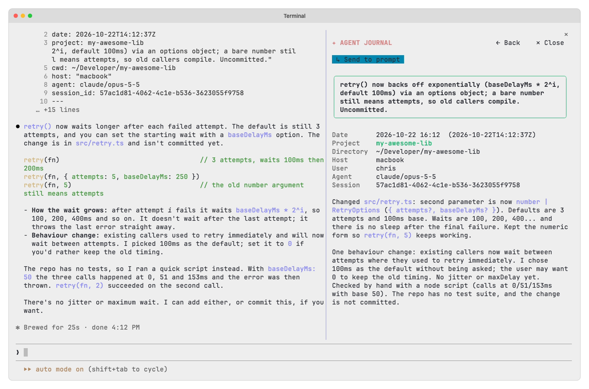

# Agent Journal for Claude Code

<picture>
  <source media="(prefers-color-scheme: dark)" srcset="../assets/claude-code-session-dark.gif" />
  
</picture>

This folder is the Claude Code plugin of [Agent Journal](../README.md). It is a [hooks module](https://code.claude.com/docs/en/plugins/mods/overview) that Claude Code loads itself. The plugin gives each session the rules for the journal and three tools to write and read it, opens the journal pane with `/agent-journal`, and syncs the journal with git when you turn sync on.

> [!NOTE]
> This page describes only the Claude Code plugin. For the entry format, the configuration, git sync and the CLI, see the [main README](../README.md).

## Install

The plugin needs Claude Code 2.1.287 or later. Install it:

```
/plugin marketplace add zirkelc/agent-plugins
/plugin install agent-journal@zirkelc
```

Then open a new session and ask Claude to write a journal entry. By default, it writes to the directory `~/agent-journal/`. To use a different directory, see [Configuration](../README.md#configuration).

## Update

Get the latest marketplace catalog, then update the plugin:

```sh
claude plugin marketplace update zirkelc
claude plugin update agent-journal@zirkelc
```

Then restart Claude Code or run `/reload-plugins` to load the new version.

## Tools

The model writes and reads the journal with three tools of the plugin. They are the same tools that the Pi extension gives:

- `write` adds one entry. The model gives only the summary and the body. The tool sets the date, the project, the directory, the host, the user, the agent and the session.
- `list` lists entries by project, date, directory, host, user or agent, searches the summaries and bodies with regex terms, and counts the matches per project, day, host, user or agent.
- `read` returns entries in full: the latest, one or more by id, or all the entries of a day, a month or a year.

Only the main conversation can use `write`. The rules name the tools, so the model loads `list` and `read` only when you ask about past work.

## Permissions

You can allow the tools with a rule in `~/.claude/settings.json`, as for any other tool:

```json
{
  "permissions": {
    "allow": ["mcp__agent-journal__write", "mcp__agent-journal__list", "mcp__agent-journal__read"]
  }
}
```

At the moment, Claude Code does not ask for permission before a call of these tools, in any permission mode, also without a rule. A mod answers the calls of its own tools, and then Claude Code does not do a permission check ([anthropics/claude-code#104217](https://github.com/anthropics/claude-code/issues/104217)). Only a deny rule has an effect: it removes the tool from the model's list.

## Hooks

The plugin gives the rules for writing the journal to the main conversation as a hidden message. It does this when the session starts, and again after `/clear` or a compaction. Subagents do not get them, so only the main conversation writes entries.

On a Team or Enterprise plan, or on a machine with managed settings, Claude Code loads a [built-in guard](https://code.claude.com/docs/en/plugins/mods/admin#know-what-happens-by-default) that keeps plugins out of the session's start-up context. There, the plugin adds the rules to your first prompt instead, and to the first prompt after `/clear` or a compaction. A prompt that you send while a compaction runs can miss them. Then the plugin adds them to the next prompt.

The rules name the journal directory from the config at the start of the session. A change to the config takes effect in the next session.

## Journal pane

`/agent-journal` opens a pane beside the conversation. In a narrow terminal, the pane opens when you make the terminal wider.

<picture>
  <source media="(prefers-color-scheme: dark)" srcset="../assets/claude-code-pane-dark.png" />
  
</picture>

- **Project:** `All` lists the entries of all projects. `Current` lists only the entries of the current repository. The pane keeps this choice for the next session.
- **Date:** `All` shows all dates. `Year`, `Month` and `Day` narrow the list to one period, and `‹` and `›` step to the period before or after it.
- **List:** It groups the entries by day, newest first. Older entries load when you scroll near the end.
- **Entry:** Press an entry to read it. The pane shows its fields (date, project, directory, host, user, agent and session) and its body. `↳ Send to prompt` puts the whole entry into the prompt.
- **Back:** `← Back` or Esc goes from an entry back to the list. Esc in the list closes the pane.

<picture>
  <source media="(prefers-color-scheme: dark)" srcset="../assets/claude-code-pane-entry-dark.png" />
  
</picture>

The last row of the list shows the journal directory. When git sync is on, it also shows `⇅` with the result of the last sync: green after a push, red with the reason after a failure.

## Git sync

When sync is on (see [Git sync](../README.md#git-sync) for the setup), the plugin runs a sync when the session starts, after the model writes an entry with the `write` tool or with the Write tool, and once more when the session ends if the exit leaves time for it. The sync at the start pulls the entries of your other machines, and the pane shows them when it is done. The sync runs in the background, so the session and the turn do not wait for the network.

## What the plugin runs, reads and sends

- **Programs:** The plugin runs one program, its own [`scripts/agent-journal`](scripts/agent-journal). This is a readable POSIX shell script, not a compiled program. The plugin finds it in its own folder and never runs an `agent-journal` from your `PATH`. The plugin runs the script with one of these subcommands:
  - `context` makes the journal rules for the session.
  - `config` reads the settings.
  - `write` writes the entry that the model gives to the `write` tool.
  - `list` and `read` get the entries for the pane and for the `list` and `read` tools.
  - `sync` runs git sync: `git add`, `git commit`, `git pull --rebase` and `git push`. A push to an SSH remote makes git start `ssh` in batch mode, so it never asks for a password. Git uses your own git setup to reach the remote (your SSH key or your credential helper). The plugin itself reads no credential and sends none anywhere.

  The script uses standard shell tools (such as `awk`, `grep` and `ls`) and `git`. It runs `git rev-parse` to find the project of a directory.

- **Reads:** The plugin reads the conversation only to find out whether the journal rules are already in it. It looks for the mark that starts the rules and reads nothing else from the messages. Through the script, it reads `~/.config/agent-journal/config` and the journal folder. It also looks up the plugin's own folder to find the script.
- **Sends:** The plugin sends no text from the conversation anywhere. The rules go into your own session, as a hidden message or as context of your prompt. Entries leave your machine only through git sync, to the remote that you set. Git sync is off until you turn it on.
- **Hooks:** The plugin adds the rules to a prompt's context when the conversation does not have them. It watches calls of the Write tool that write into the journal folder, to refresh the pane and to start a sync. It does not change those calls.
- **Tools:** The plugin gives the model the three tools in [Tools](#tools), and it answers their calls itself: it runs `scripts/agent-journal` with `write`, `list` or `read` and gives back the output. It answers no other tool.
- **Agents:** The plugin starts no agent in this version. It has the code for a search agent, but that agent is off. If it were on, the agent would get only your question and the `list` and `read` tools. It could not write, edit or run commands.
